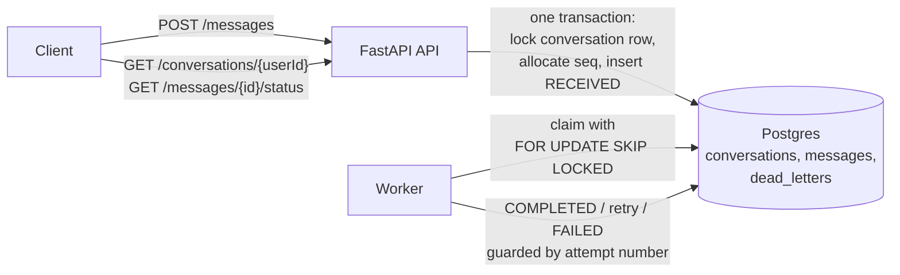
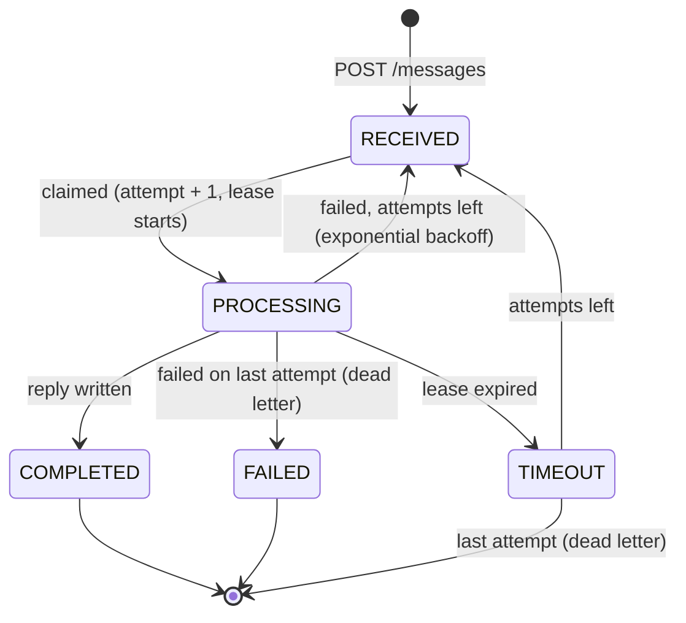

# AILA Messaging Backend

Messaging backend for the AILA assistant chat. A client sends a message and gets an answer straight away with the message id, its position in the conversation and the state `RECEIVED`. The assistant reply arrives later from a background worker, which may be slow and may fail. The service makes sure that:

- every message is stored durably before any work starts,
- replies attach to the message that asked for them,
- a conversation always reads back in the order the user sent it, even when replies finish out of order,
- a client retrying the same send never creates a second message,
- failed or stalled work is retried a bounded number of times and then recorded as a dead letter.

The assistant itself is simulated. The worker sleeps for a random delay, fails at a configurable rate, and otherwise writes back `[AI] Response (attempt N): <your text>`. The hook for a real model is `process_job` in `backend/worker/worker.py`.

## How it works



Each message moves through this state machine:



`flowchart.png` is the original design sketch. It also shows SSE pushes and a logs/metrics/tracing box. Those are not built yet; clients poll for now.

### Design choices

- **Send order through a per-conversation counter.** `conversations.next_seq` is read `FOR UPDATE` and bumped in the same transaction that inserts the message. Concurrent sends to one conversation queue on that row lock and get gap-free `seq` values 1, 2, 3, …. Different conversations never block each other. Listings sort by `seq`, not by completion time.
- **Idempotency keyed by `(user_id, conversation_id, client_message_id)`.** A unique constraint backs it, and the duplicate lookup runs after the row lock is taken, so a burst of identical retries yields one message. The response is the original message every time. If the client omits the key, the server generates one, and that send cannot be deduplicated.
- **Postgres as the queue.** Workers claim rows with `FOR UPDATE SKIP LOCKED`, so several worker processes can run side by side without handing out the same message twice. Each worker keeps at most `CONCURRENCY` jobs in flight and claims only for free slots, so a claimed job never sits waiting while its lease runs.
- **Leases and fencing.** A claim stamps `processing_deadline_at`. A reaper pass on every tick moves expired leases to `TIMEOUT` and requeues them. Every write-back also matches on `attempt_count`, so a worker that stalled past its lease cannot overwrite the result of the attempt that replaced it.
- **Dead letters.** Messages that exhaust `MAX_ATTEMPTS`, whether by failure or by timeout, get a `dead_letters` row in the same transaction as their final state change.

## Running it

Requirements: Docker with Compose v2.

```bash
cp .env.example .env   # optional; every value has a default
docker compose up --build
```

The API listens on http://localhost:8000, and the interactive OpenAPI docs are at http://localhost:8000/docs. Postgres is not published to the host. To inspect it, run:

```bash
docker compose exec db psql -U postgres -d aila
```

Stop the stack and drop its data with `docker compose down -v`.

### Configuration

All of these are read from `.env` by Compose. `.env.example` lists them with their defaults.

| Variable | Default | Meaning |
| --- | --- | --- |
| `POSTGRES_USER` / `POSTGRES_PASSWORD` / `POSTGRES_DB` | `postgres` / `postgres` / `aila` | Database credentials, shared by the API and the worker |
| `API_PORT` | `8000` | Host port for the API |
| `MIN_DELAY_SECONDS` / `MAX_DELAY_SECONDS` | `3` / `60` | Simulated processing time per attempt |
| `FAIL_RATE` | `0.2` | Probability that a simulated attempt fails |
| `CONCURRENCY` | `8` | Jobs one worker processes at once |
| `CLAIM_BATCH` | `10` | Most rows claimed in one query |
| `MAX_ATTEMPTS` | `3` | Attempts before a message is dead-lettered |
| `PROCESSING_TIMEOUT_SECONDS` | `300` | Lease per attempt before the reaper steps in |

To add worker throughput, run `docker compose up --scale worker=3`.

## API

| Method | Path | Purpose |
| --- | --- | --- |
| `POST` | `/messages` | Store a message and queue it. Returns `201` with the message, including on an idempotent replay. |
| `GET` | `/conversations/{userId}?conversation_id=` | All of a user's messages, grouped by conversation and ordered by `seq`. |
| `GET` | `/messages/{messageId}/status` | State, reply, last error and attempt count for one message. |

### Examples

The responses below were captured from the Compose stack, with the worker delay shortened through `.env`.

Send three messages in quick succession:

```bash
curl -s -X POST http://localhost:8000/messages \
  -H 'Content-Type: application/json' \
  -d '{"user_id":"u1","conversation_id":"c1","text":"What is tax deduction?","client_message_id":"22222222-2222-2222-2222-222222222222"}'
```

```json
{
  "message_id": "293da02a-fcf4-4561-9986-748e9d11b823",
  "user_id": "u1",
  "conversation_id": "c1",
  "client_message_id": "22222222-2222-2222-2222-222222222222",
  "seq": 2,
  "text": "What is tax deduction?",
  "state": "RECEIVED",
  "assistant_text": null,
  "last_error": null,
  "created_at": "2026-11-08T19:55:26.404772Z",
  "updated_at": "2026-11-08T19:55:26.404773Z"
}
```

Sending the third message again with the same `client_message_id` returns the stored message, `seq: 3` with the same `message_id`, rather than creating a fourth.

A few seconds later, the conversation reads back in send order with the replies attached. Fields not relevant here are trimmed to `"..."`:

```bash
curl -s "http://localhost:8000/conversations/u1?conversation_id=c1"
```

```json
{
  "user_id": "u1",
  "conversations": [
    {
      "conversation_id": "c1",
      "messages": [
        { "seq": 1, "text": "Hi", "state": "COMPLETED",
          "assistant_text": "[AI] Response (attempt 1): Hi", "...": "..." },
        { "seq": 2, "text": "What is tax deduction?", "state": "COMPLETED",
          "assistant_text": "[AI] Response (attempt 1): What is tax deduction?", "...": "..." },
        { "seq": 3, "text": "Give an example also", "state": "COMPLETED",
          "assistant_text": "[AI] Response (attempt 1): Give an example also", "...": "..." }
      ]
    }
  ]
}
```

Here is a message polled through a failed first attempt and a successful retry, with `FAIL_RATE=0.7`. Each line is one distinct status response from `GET /messages/{id}/status`, trimmed to the changing fields:

```json
{"state":"RECEIVED","attempt_count":0,"last_error":null,"assistant_text":null}
{"state":"PROCESSING","attempt_count":1,"last_error":null,"assistant_text":null}
{"state":"RECEIVED","attempt_count":1,"last_error":"simulated failure after 1s (attempt 1)","assistant_text":null}
{"state":"PROCESSING","attempt_count":2,"last_error":"simulated failure after 1s (attempt 1)","assistant_text":null}
{"state":"COMPLETED","attempt_count":2,"last_error":null,"assistant_text":"[AI] Response (attempt 2): Can I deduct home office costs?"}
```

An unknown id returns `404 {"detail":"Message not found"}`. A malformed id or empty text returns `422`.

## Tests

The suite runs against a real Postgres, because the row locks, `SKIP LOCKED` and constraints are the behaviour under test. It covers sequence allocation under concurrent sends, idempotent and concurrent duplicate submissions, per-user key isolation, listing and status endpoints, and the worker's claim, complete, retry, dead-letter, lease-reaping and stale-attempt paths, including the run loop.

```bash
docker compose --profile test run --rm tests
docker compose --profile test down -v
```

This starts a throwaway `test-db` and runs `ruff check` and `pytest` in `backend/`. To run against a database of your own, use `DATABASE_URL=postgresql+asyncpg://… pytest` from `backend/` after `pip install -r requirements-dev.txt`. The suite truncates the tables it uses, so never point it at real data.

## Layout

```
backend/
  app/        FastAPI app: models, schemas, crud (seq + idempotency), settings
  worker/     polling worker: claim, process, retry, reap, dead-letter
  tests/      pytest suite (API and worker)
docker-compose.yml   db, api, worker; test-db and tests under the "test" profile
```

## Limitations and next steps

- Tables are created with `create_all` at startup. There are no migrations, so schema changes (such as the per-user idempotency constraint) need a fresh database. Alembic is the obvious next step.
- Clients poll. SSE or WebSocket pushes on state changes would remove that.
- No authentication or rate limiting. `user_id` is taken from the request body as given.
- No cancellation endpoint, and no metrics for queue depth, latency or dead-letter count yet.

## License

MIT. See [LICENSE](LICENSE).
